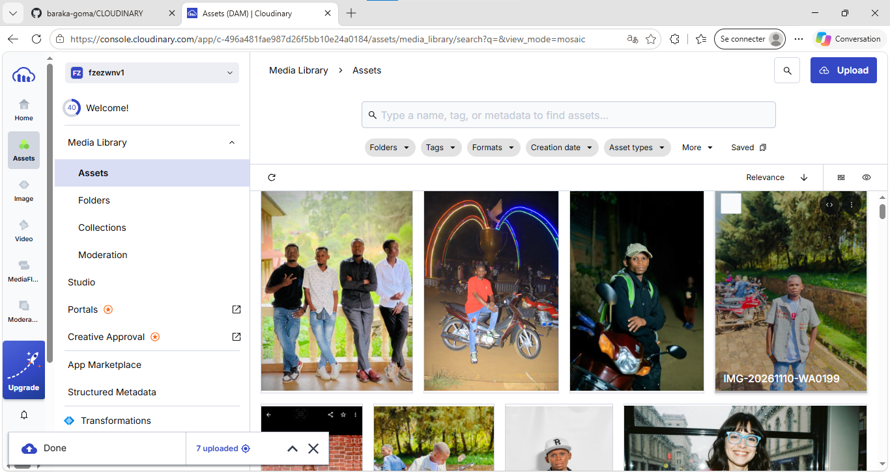

# Fragments — Galerie Cloudinary

Une galerie photo responsive qui présente sept images hébergées sur Cloudinary. Une photographie à la une vous accueille; une section éditoriale explique comment parcourir la collection. Sélectionnez une photo pour l’agrandir, consulter son URL originale, la copier ou télécharger le fichier.

**Site publié :** [https://baraka-goma.github.io/CLOUDINARY/](https://baraka-goma.github.io/CLOUDINARY/)

**Dépôt GitHub :** [baraka-goma/CLOUDINARY](https://github.com/baraka-goma/CLOUDINARY)

> Le site est un projet statique : il n’y a ni serveur applicatif ni clé secrète dans le code. Les images sont demandées directement à Cloudinary.

## Aperçu de la bibliothèque Cloudinary

La capture ci-dessous montre la bibliothèque média utilisée pour le projet.



## Fonctionnalités

- **Galerie interactive :** les sept vignettes sont cliquables et ouvrent une fiche détaillée.
- **Photo à la une :** une image Cloudinary mise en avant dans l’accueil s’ouvre elle aussi dans sa fiche.
- **Fiche de chaque image :** aperçu agrandi, nom du fichier et URL Cloudinary complète et cliquable.
- **Copie en un clic :** bouton pour copier le lien original; un message indique si la copie a réussi.
- **Téléchargement :** lien de téléchargement direct servi par Cloudinary, sans conserver de copie des images dans le dépôt.
- **Recherche :** filtre les photos par nom de fichier; la touche `/` place le curseur dans le champ.
- **Présentation enrichie :** introduction à la collection, repères sur les images et guide simple en trois étapes.
- **Responsive et accessible :** mise en page pour mobile, tablette et ordinateur, navigation au clavier, libellés accessibles et prise en compte de la réduction des animations.
- **Chargement optimisé :** vignettes chargées à la demande et images optimisées par la diffusion Cloudinary.
- **Publication automatisée :** GitHub Actions publie le site sur GitHub Pages après chaque changement sur `main`.

## Images Cloudinary utilisées

Ces URLs sont les URLs publiques exactes des images de la galerie. Elles fonctionnent sans identifiant ni clé API.

| Fichier | URL publique |
|---|---|
| `me.jpg` | [Ouvrir l’image](https://res.cloudinary.com/fzezwnv1/image/upload/v1794312105/me.jpg) |
| `bk.jpg` | [Ouvrir l’image](https://res.cloudinary.com/fzezwnv1/image/upload/v1794312104/bk.jpg) |
| `me4.jpg` | [Ouvrir l’image](https://res.cloudinary.com/fzezwnv1/image/upload/v1794312102/me4.jpg) |
| `me3.jpg` | [Ouvrir l’image](https://res.cloudinary.com/fzezwnv1/image/upload/v1794312102/me3.jpg) |
| `me1.jpg` | [Ouvrir l’image](https://res.cloudinary.com/fzezwnv1/image/upload/v1794312102/me1.jpg) |
| `me2.jpg` | [Ouvrir l’image](https://res.cloudinary.com/fzezwnv1/image/upload/v1794312102/me2.jpg) |
| `me5.jpg` | [Ouvrir l’image](https://res.cloudinary.com/fzezwnv1/image/upload/v1794312101/me5.jpg) |

## Technologies

- HTML5 pour la structure et les éléments accessibles;
- CSS3 pour la mise en page responsive, les animations et la présentation;
- JavaScript natif pour la recherche, la galerie, la fiche image et les actions;
- Cloudinary pour l’hébergement et la diffusion des sept photos;
- GitHub Actions et GitHub Pages pour la publication.

Aucun framework, paquet npm, serveur ou configuration locale n’est nécessaire.

## Lancer le projet localement

1. Clonez le dépôt et ouvrez son dossier :

   ```bash
   git clone https://github.com/baraka-goma/CLOUDINARY.git
   cd CLOUDINARY
   ```

2. Ouvrez `index.html` dans un navigateur. Les photos sont chargées depuis Cloudinary; une connexion Internet est donc nécessaire.

Pour tester les mêmes conditions qu’un hébergement HTTP, vous pouvez aussi utiliser un serveur statique local, par exemple l’extension **Live Server** de VS Code.

## Publication sur GitHub Pages

Le workflow [`.github/workflows/pages.yml`](.github/workflows/pages.yml) prépare et publie le site à chaque push vers `main`. Pages est activé pour ce dépôt. Si vous configurez le projet dans un autre dépôt, choisissez **GitHub Actions** comme source dans **Settings → Pages** avant son premier déploiement.

Vérifiez les déploiements dans l’onglet **Actions** du dépôt. Après publication, l’adresse du site figure aussi dans **Settings → Pages**.

## Ajouter ou remplacer une image

1. Téléversez une image que vous avez le droit de publier dans votre bibliothèque Cloudinary.
2. Copiez son URL publique **Secure URL**, par exemple `https://res.cloudinary.com/<cloud-name>/image/upload/v1234567890/nom.jpg`.
3. Ajoutez son nom et son URL dans le tableau `images` de [`app.js`](app.js). Utilisez la même URL pour la page et la vignette afin que l’image demeure hébergée sur Cloudinary.
4. Publiez le changement sur `main`; GitHub Actions redéploie la galerie.

## Sécurité et droits

- N’ajoutez jamais d’**API secret**, de clé privée ou de jeton Cloudinary à `app.js`, à une page HTML ou au dépôt GitHub.
- Les URLs d’images incluses ici sont des liens de diffusion publics : toute personne qui les possède peut ouvrir les images.
- Publiez uniquement des images dont vous avez les droits et vérifiez que leur accès public correspond à votre choix.

## Structure du projet

```text
.
├── .github/workflows/pages.yml   # Publication automatique sur GitHub Pages
├── app.js                        # URLs, cartes, recherche et fiche détaillée
├── docs/cloudinary-dashboard.png # Capture de la bibliothèque Cloudinary
├── index.html                    # Page de la galerie
├── README.md                     # Présentation et instructions
└── styles.css                    # Styles responsive
```
